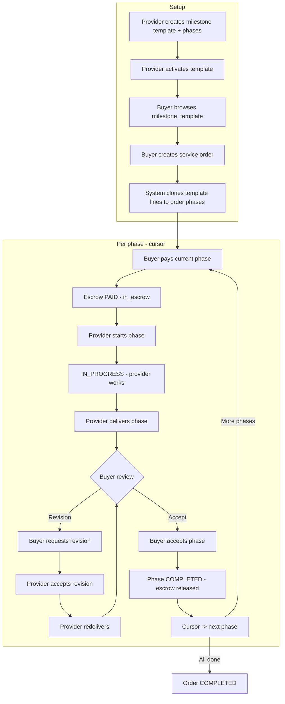

# Milestone Package — Per-Phase Payment & Execution

A **milestone package order** splits work into ordered **phases**. Each phase has its own budget, duration, revision window, payment, delivery, and acceptance. Only the **cursor phase** (current phase) can be paid or worked on.

**Base API:** `/api/v1`

---

## Scenario overview

A provider sells a 3-phase package:

| Phase | Duration | Budget | Revision window |
|-------|----------|--------|-----------------|
| Discovery | 5 days | $500 | 2 days |
| Design | 10 days | $1,000 | 3 days |
| Development | 15 days | $2,000 | 5 days |

The buyer does **not** pay $3,500 upfront. They pay **one phase at a time**. The provider starts a phase only after it is paid. After each delivery, the buyer accepts the phase (or requests a revision). When a phase is completed, the **cursor** moves to the next phase.

### Example mid-project state

| Phase | Duration | Budget | Execution status | Payment status | Revision window |
|-------|----------|--------|------------------|----------------|-----------------|
| Discovery | 5 days | $500 | **COMPLETED** | paid (released) | 2 days |
| Design | 10 days | $1,000 | **IN_PROGRESS** ← cursor | in_escrow | 3 days |
| Development | 15 days | $2,000 | PENDING_PAYMENT | unpaid | 5 days |

---

## Phase status lifecycle

Each **order phase** (`service_offer_order_phases`) moves through:

```
PENDING_PAYMENT → IN_PROGRESS → DELIVERED → COMPLETED
                      ↑            │
                      └── IN_REVISION (optional, after buyer requests revision)
```

| Status | Meaning |
|--------|---------|
| `PENDING_PAYMENT` | Phase not started. Buyer must pay; provider cannot start until paid. |
| `IN_PROGRESS` | Paid and started; provider is working; deadline = started_at + duration_days. |
| `DELIVERED` | Provider submitted deliverables; buyer may accept or request revision (within window). |
| `IN_REVISION` | Provider accepted a revision request; provider must redeliver. |
| `COMPLETED` | Buyer accepted; escrow released; cursor advances to next phase. |

**Payment status** (derived from phase escrow, separate from execution status):

| Payment status | Meaning |
|----------------|---------|
| `unpaid` | No escrow for this phase |
| `in_escrow` | Buyer paid; funds held until phase accepted |
| `paid` | Escrow released after buyer accepts phase |

---

## Cursor

The order stores `current_phase_id` — the single active phase.

**Cursor actions** (API field `cursor.action`):

| action | Who | When |
|--------|-----|------|
| `pay` | Buyer | Phase is `PENDING_PAYMENT` and unpaid |
| `start` | Provider | Phase is `PENDING_PAYMENT` and paid |
| `deliver` | Provider | Phase is `IN_PROGRESS` |
| `review` | Buyer | Phase is `DELIVERED` (accept or request revision) |
| `deliver_revision` | Provider | Phase is `IN_REVISION` and revision was accepted |
| `none` | — | Package completed (no current phase) |

The cursor moves to the **next phase** (by `sort_order`) only when the buyer **accepts** the current phase.

---

## Flowchart



---

## Provider flow (step by step)

### A. Create & publish package

1. Complete service-provider profile.
2. `POST /api/v1/milestones` — create package with `services[]` (phases).
3. `POST /api/v1/milestones/toggle-activation/{id}` — publish (requires ≥1 service line).

### B. When a buyer orders

4. Buyer creates order → phases are cloned to `service_offer_order_phases`.
5. Order `status` = `PENDING_PAYMENT`, cursor = first phase.

### C. Per phase (repeat until package complete)

6. Wait for buyer to pay current phase (`POST .../phases/{phase}/pay`).
7. `POST /api/v1/provider-orders/{order}/phases/{phase}/start` — only if phase is paid and is cursor.
8. Work until deadline (`deadline` on phase).
9. `POST /api/v1/provider-orders/{order}/phases/{phase}/deliver` — attach files/message.
10. If buyer requests revision:
    - `POST /api/v1/provider-orders/revisions/{revision}/accept` (or reject)
    - If accepted: `POST .../phases/{phase}/deliver` again
11. When buyer accepts phase, cursor moves; repeat from step 6 for next phase.

**Do not use** order-level `start/{id}` or `deliver/{id}` for milestone orders — use phase endpoints.

---

## Buyer flow (step by step)

### A. Discover & order

1. `GET /api/v1/services?orderable_type=milestone_template`
2. `GET /api/v1/services/show/{id}?orderable_type=milestone_template`
3. `POST /api/v1/service-orders` with `orderable_type: milestone_template`, `orderable_id`, optional `notes`/`attachments`.

### B. Per phase (cursor)

4. `GET /api/v1/service-orders/show/{id}` — inspect `phases[]` and `cursor`.
5. `POST /api/v1/service-orders/{order}/phases/{phase}/pay` — pay current phase only.
6. Wait for provider to start and deliver.
7. On delivery:
   - **Accept:** `POST .../phases/{phase}/accept` → phase `COMPLETED`, cursor advances.
   - **Revision:** `POST .../phases/{phase}/revisions` with `delivery_version`, `notes` (within `revision_window_days`).

**Do not use** order-level `POST .../revisions` for milestone orders.

---

## API reference (milestone orders)

### Buyer

| Method | Path | Description |
|--------|------|-------------|
| POST | `/service-orders` | Create order (clones phases) |
| GET | `/service-orders/show/{id}` | Details + `phases` + `cursor` |
| POST | `/service-orders/{order}/phases/{phase}/pay` | Pay cursor phase |
| POST | `/service-orders/{order}/phases/{phase}/accept` | Accept delivered phase |
| POST | `/service-orders/{order}/phases/{phase}/revisions` | Request revision on phase |

### Provider

| Method | Path | Description |
|--------|------|-------------|
| POST | `/provider-orders/{order}/phases/{phase}/start` | Start paid cursor phase |
| POST | `/provider-orders/{order}/phases/{phase}/deliver` | Deliver cursor phase |
| POST | `/provider-orders/revisions/{revision}/accept` | Accept phase revision |
| POST | `/provider-orders/revisions/{revision}/reject` | Reject phase revision |

---

## Data model

```
service_offer_orders
├── current_phase_id          → active cursor phase
├── orderable → Milestone template
└── phases[] → service_offer_order_phases

service_offer_order_phases
├── service_name, duration_days, budget, revision_window_days, sort_order
├── status (execution)
├── started_at, deadline, delivered_at, completed_at
├── escrows[] (per-phase payment)
├── deliveries[] (per-phase)
└── revisions[] (per-phase)
```

Template lines (`milestone_services`) are **snapshotted** at order creation; later template edits do not affect existing orders.

---

## Order-level vs phase-level status

| Level | Role |
|-------|------|
| **Order** `status` | Overall package: `PENDING_PAYMENT` → `IN_PROGRESS` → `DELIVERED` / `REVISION_REQUESTED` → `COMPLETED` |
| **Phase** `status` | Current step in the loop above |
| **Cursor** | Which phase receives pay/start/deliver/accept actions |

---

## Comparison with single service offer

| | Service offer | Milestone package |
|--|---------------|-------------------|
| Payment | One payment for full order | One payment **per phase** |
| Start / deliver | Order-level endpoints | **Phase** endpoints |
| Revisions | Order-level | **Per phase** |
| Cursor | N/A | `current_phase_id` + `cursor.action` |

---

## Related code

| Area | Path |
|------|------|
| Phase service | `app/Services/MilestoneOrderPhaseService.php` |
| Migration | `database/migrations/2026_05_16_120000_create_service_offer_order_phases_table.php` |
| Enum | `app/Enums/MilestoneOrderPhaseStatus.php` |
| Model | `app/Models/ServiceOfferOrderPhase.php` |
